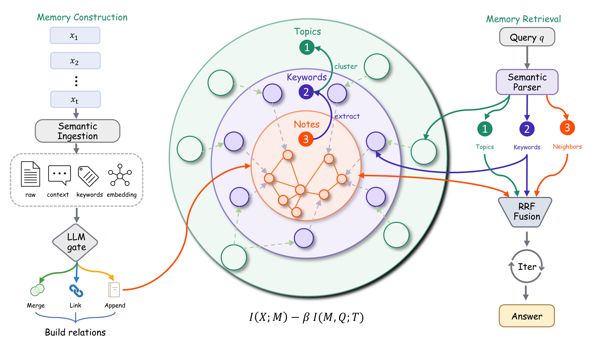

# 🧠 MemCoRe

**Recovering Evidence from Progressively Compressed Factual Knowledge for Agent Memory**

<div align="left">
  <p>
    <a href="https://arxiv.org/abs/2602.07885"></a>
    <a href="LICENSE"></a>
    <a href="AGENTS.md"></a>
    <a href="CITATION.bib"></a>
    <a href="README_zh.md"></a>
  </p>
  <p>
    <a href="https://github.com/Liar-zzy/MemCoRe/stargazers"></a>
    <a href="https://github.com/Liar-zzy/MemCoRe/issues"></a>
  </p>
</div>

MemCoRe organizes agent memory as a hierarchy of **notes, keywords, and topics**, progressively compressing redundancy while preserving structure for evidence retrieval. It combines gated memory construction with multi-level retrieval and iterative evidence refinement.

This release provides the MemCoRe implementation and LoCoMo evaluation pipeline. The default models are **Qwen3-8B** and **Qwen3-Embedding-0.6B**.



## 🗂️ Graph storage in this release

The original implementation used Neo4j. Community Edition supports one user database per DBMS instance, so experiments with independent graph states require application-level isolation or separate instances. See the [Neo4j documentation](https://neo4j.com/docs/operations-manual/current/database-administration/).

To simplify deployment and support parallel experiments and future extensions, this release uses a lightweight in-process graph implementation: NumPy for vector search, and NetworkX/graspologic for graph analysis and topic clustering. Each conversation owns an independent graph that can be saved and restored as JSON. This makes graph isolation, resets, and snapshots easier to manage without an external database service.

## 🚀 Quick start

### 1. Install dependencies

Use Python 3.11, which is the tested environment:

```bash
git clone https://github.com/Liar-zzy/MemCoRe.git
cd MemCoRe
python3.11 -m venv .venv
source .venv/bin/activate
python -m pip install -r requirements.txt
python -m nltk.downloader punkt punkt_tab
```

Run the code directly with `python run.py`; MemCoRe itself does not need to be installed. The evaluator runs on CPU and calls separate chat and embedding services.

### 2. Connect the models

Connect your OpenAI-compatible chat and embedding endpoints:

```bash
export MEMCORE_LLM_BASE_URL=http://127.0.0.1:8000/v1
export MEMCORE_EMBEDDING_BASE_URL=http://127.0.0.1:8001/v1
```

The defaults already use these addresses. For authenticated services, set `MEMCORE_LLM_API_KEY` and `MEMCORE_EMBEDDING_API_KEY`. Model names and decoding options are in [configs/llm.yaml](configs/llm.yaml); Qwen3 thinking is disabled for this configuration.

<details>
<summary>Start local models with vLLM (two GPUs)</summary>

Create a separate environment for model serving:

```bash
conda create -n memcore-serve python=3.11 -y
conda activate memcore-serve
python -m pip install vllm==0.10.0
```

Start the chat model:

```bash
CUDA_VISIBLE_DEVICES=0 python -m vllm.entrypoints.openai.api_server \
  --model Qwen/Qwen3-8B \
  --served-model-name Qwen/Qwen3-8B \
  --host 127.0.0.1 --port 8000 \
  --dtype bfloat16 --tensor-parallel-size 1 \
  --seed 42 --max-model-len 32768 --max-num-seqs 32 \
  --gpu-memory-utilization 0.80 --enable-prefix-caching \
  --generation-config vllm \
  --override-generation-config '{"max_new_tokens":8192}'
```

In another terminal, activate the serving environment and start the embedding model:

```bash
CUDA_VISIBLE_DEVICES=1 python -m vllm.entrypoints.openai.api_server \
  --model Qwen/Qwen3-Embedding-0.6B \
  --served-model-name Qwen/Qwen3-Embedding-0.6B \
  --host 127.0.0.1 --port 8001 \
  --task embed --dtype bfloat16 --tensor-parallel-size 1 \
  --seed 42 --max-model-len 32768 \
  --gpu-memory-utilization 0.20
```

These commands match the two-GPU H800 setup used for the reproduction. Adjust GPU memory fractions for your hardware. Local model directories can replace `--model` while keeping the served model names. For remote services, use accessible endpoints or SSH port forwarding.

The client uses request seed 42 and top-p 1.0. Answer temperature is 0.7 for C1–C4 and 0.5 for C5. The embedding model returns 1,024-dimensional vectors; use the same embedding model for construction and retrieval.

Return to the evaluator environment and repository directory for the commands below.

</details>

<details>
<summary>Use Qwen3-14B or GPT-4o</summary>

For Qwen3-14B, replace both model names in the chat server command above with `Qwen/Qwen3-14B`, then run:

```bash
python run.py --llm-config-path configs/llm_qwen3_14b.yaml --name locomo_qwen3_14b
```

For GPT-4o, set `OPENAI_API_KEY` in your environment and use its dedicated configuration:

```bash
python run.py --llm-config-path configs/llm_gpt4o.yaml --name locomo_gpt4o
```

This uses OpenAI's Chat Completions API without Qwen/vLLM-specific request parameters. To use a provider-specific endpoint or an available model snapshot, add `--base-url` or `--model`. OpenAI has announced a January 14, 2027 shutdown for its GPT-4o snapshots; see the [official deprecation schedule](https://developers.openai.com/api/docs/deprecations).

Both configurations keep **Qwen3-Embedding-0.6B** as a separate service. Changing the chat model applies to memory construction, query analysis, and answering; each `--name` gets its own graph and results. To start with the small example, add `--dataset examples/smoke_locomo.json` and use a separate run name.

</details>

### 3. Run a small example

The included example has six conversation turns and five questions covering all five LoCoMo categories:

```bash
python run.py --dataset examples/smoke_locomo.json --name demo
python scripts/summarize.py results/demo
```

This builds a graph, retrieves evidence, generates answers, and computes F1 and BLEU-1. Results are written to `results/demo/`, and the graph is saved under `cached/cached_mem_key_graph_v3/demo/`.

### 4. Evaluate LoCoMo

Download the dataset from the [official LoCoMo repository](https://github.com/snap-research/locomo):

```bash
python scripts/download_data.py
python run.py
python scripts/summarize.py results/locomo_qwen3_8b
```

The default run evaluates **all 10 conversations and 1,986 questions**. It constructs each conversation's graph once and then answers its questions. To try one conversation first:

```bash
python run.py --sample-indices 0 --name locomo_sample0
```

Run the same command again to resume an interrupted run. Use a new `--name` when changing models or experiment settings.

## 📖 Citation

Please cite our paper if you use MemCoRe:

```bibtex
@misc{zhang2026memcorerecoveringevidenceprogressively,
      title={MemCoRe: Recovering Evidence from Progressively Compressed Factual Knowledge for Agent Memory},
      author={Zhenyuan Zhang and Xianzhang Jia and Zhiqin Yang and Zhenbo Song and Wei Xue and Sirui Han and Yike Guo},
      year={2026},
      eprint={2602.07885},
      archivePrefix={arXiv},
      primaryClass={cs.AI},
      url={https://arxiv.org/abs/2602.07885},
}
```

## 🙏 Acknowledgments

Our implementation builds on [A-MEM](https://github.com/WujiangXu/A-mem). We thank its authors and the [LoCoMo](https://github.com/snap-research/locomo) team for their open-source code and benchmark.

## 📄 License

Code is released under the [MIT License](LICENSE), retaining the upstream copyright notice. The dataset and model weights are obtained from their respective projects.
